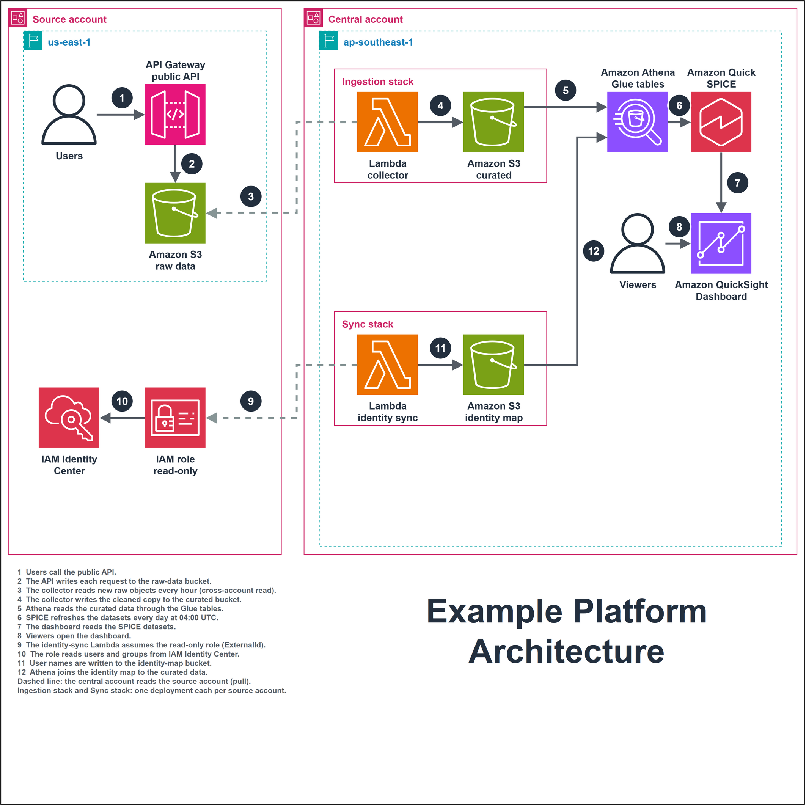

# AWS Architecture draw.io

An agent skill and a small Python toolkit for drawing AWS architecture diagrams in draw.io in one consistent
house style, and for checking them by measurement instead of by screenshot.




## The style in one paragraph

Square white canvas, 1080 x 1080. AWS account frames side by side, regions nested inside, plain boxes for logical
units. Networks use the official groups: VPC, Availability Zone, public and private subnets. Compute on Fargate is
one dashed orange frame holding the Fargate icon and one ECS task per role. Resources with their own AWS4 shape,
such as a NAT Gateway, are drawn rather than named in a frame title. 80 x 80 AWS4 icons placed close together,
each with a bold 13 px label of one or two lines (service name, then its role). Orthogonal 2.5 px arrows with no
text on them; each important arrow gets a numbered badge beside the line. One legend bottom left explains every
number in one sentence, and a large two-line title sits bottom right. No note boxes.
The full rules are in [SKILL.md](SKILL.md) (written in Vietnamese).

## Contents

| Path | What it does |
|---|---|
| `SKILL.md` | The style rules and the 7-step workflow, for an AI agent or a person |
| `scripts/aws_drawio.py` | Generator library (stdlib only) with every style constant and a geometry check |
| `scripts/verify_drawio.py` | Checks XML, dangling arrows, and that every AWS4 icon name exists in draw.io |
| `scripts/lint_style.py` | Checks any `.drawio` file, hand-edited ones included, against the style |
| `scripts/png_measure.py` | Measures a PNG exported by the draw.io CLI: size, no embedded XML, icons rendered |
| `examples/build_example.py` | A generic two-account example; copy it to start a new diagram |
| `examples/build_vpc_fargate_example.py` | VPC with two AZs, a NAT Gateway and one Fargate frame of ECS tasks |

## Quick start

```bash
curl -o Sidebar-AWS4.js https://raw.githubusercontent.com/jgraph/drawio/dev/src/main/webapp/js/diagramly/sidebar/Sidebar-AWS4.js
python examples/build_example.py Sidebar-AWS4.js my.drawio
python scripts/verify_drawio.py my.drawio Sidebar-AWS4.js --allow-missing=quicksight
python scripts/lint_style.py my.drawio --public
draw.io -x -f png -s 2 -o my.png my.drawio
python scripts/png_measure.py my.png my.drawio 2
```

Requires Python 3.9+ and, for PNG export, the draw.io desktop app.

## License

[MIT](LICENSE)
